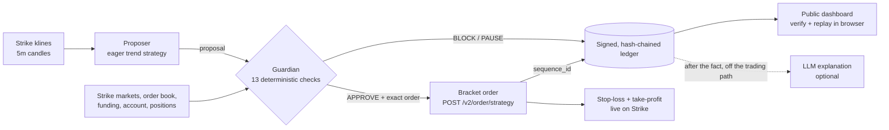

# Strike Guardian

**An autonomous perps agent for [Strike Finance](https://strikefinance.org) where no trade reaches the order book without passing a deterministic Guardian — and every decision is a signed receipt anyone can replay.**

**Live dashboard:** [strike-guardian.vercel.app](https://strike-guardian.vercel.app) · running on **Strike mainnet** with a $15 account

---

## Why

Trading bots tend to fail the same way: oversized positions, stops placed inside normal noise, correlated bets stacked on top of each other, revenge trading after a loss streak. Strike Guardian puts a 13-check risk engine between the strategy and the exchange, and makes every verdict publicly verifiable instead of asking you to trust a log file.

## How it works



1. **Proposer** reads closed 5-minute candles from Strike (EMA20/EMA50 trend, RSI, volume) and suggests trades. It is deliberately eager: it proposes at confidence ≥ 0.45, while the Guardian demands ≥ 0.60.
2. **Guardian** evaluates each proposal against live Strike data — market rules, margin tiers, the order book walked for our exact size, funding, the account and its open positions. It sizes the order to the *tightest* of its limits, then verifies the exact order it would send. Pure function: same inputs, same verdict.
3. **Execution:** an approved trade goes out as a single **bracket order**, so the stop-loss and take-profit live *on Strike*, not inside our process. If the agent dies, the position is still protected.
4. **Ledger:** every decision, order, outcome and restart is Ed25519-signed, hash-chained to the previous entry, and execution entries carry Strike's `sequence_id` / `message_id`.
5. **Explanations** (optional) are written by an LLM *after* the decision is signed and the order is sent, as their own signed entries. A slow or failing model can never delay or change a trade. Without an LLM key, a deterministic template is used and labelled as such.

## The 13 checks

| # | Check | Blocks when |
|---|---|---|
| 1 | Market whitelisted & live | Market isn't BTC/ETH/SOL-USD, isn't trading, or is reduce-only |
| 2 | Signal confidence | Below 0.60 |
| 3 | Stop-loss attached & sane | Missing, wrong side, or not 0.2–3% from entry |
| 4 | Reward-to-risk | Below 1.5R (re-measured from the live price, so stale setups fail) |
| 5 | Risk per trade | Loss at the stop > 1% of equity — on the size actually sent, including Strike's minimum order size |
| 6 | Leverage limits | Position leverage above the market's margin tier, or total account leverage above 3× |
| 7 | Margin available | Trade would lock more than 60% of available balance |
| 8 | Liquidation buffer | Estimated liquidation price is closer than 2× the stop distance |
| 9 | Funding drag | Expected funding over 4h exceeds 20% of the target |
| 10 | Spread & slippage | Spread > 0.1% or walking the book for our size slips > 0.15% |
| 11 | Exposure & correlation | Already in that market, 2 positions open, or already holding a position in the same direction |
| 12 | Daily loss limit | Equity down ≥ 5% since the UTC day opened → **pause** |
| 13 | Loss-streak cooldown | 2 consecutive losses → **pause** for 120 minutes |

The policy is versioned and hashed; the hash is in every decision so you can see exactly which rules produced it.

## How it uses Strike

- **API wallets** — Ed25519 request signing (`{METHOD}:{PATH}:{TIMESTAMP}:{NONCE}:{BODY_HASH}`), with clock sync against `/v2/time`. These keys can trade but **cannot withdraw or deposit**.
- **Market rules** — `/v2/markets` for margin tiers, maintenance margin rates, minimum sizes, step/tick grids, minimum notional and hourly funding.
- **Order book** — `/price/v2/depth`, walked level by level for the exact order size to measure real slippage.
- **Candles** — `/price/v2/klines` (closed candles only).
- **Bracket orders** — `/v2/order/strategy` with take-profit and stop legs on mark price.
- **Account controls** — isolated margin (`/v2/marginMode`) and fixed leverage (`/v2/leverage`) set at startup for every tradable market.
- **Kill switch** — `/v2/order/cancel-all` plus reduce-only market closes.
- **Builder codes** — orders can carry `X-Builder-Fee-Bps`, so a hosted Guardian can earn a fee on the trades it protects.

## Results (live on Strike mainnet)

_Generated by `npm run report` from the signed ledger at 2026-10-22 18:07 UTC. Ledger integrity: all hashes, signatures and chain links valid ✓._

- Live since **2026-10-22 12:27 UTC** (5.7 hours), $15 account
- **58** proposals judged: **4 approved**, **54 blocked**, **0 paused**
- **4** bracket orders sent to Strike · **3** closed on Strike by their own stop-loss or take-profit 
- Equity now **$15.06**

**Why trades were stopped** (a blocked proposal can fail several checks):

| Check | Times it stopped a trade |
|---|---|
| Exposure & correlation | 52 |
| Market whitelisted & live | 19 |
| Signal confidence | 15 |
| Margin available | 12 |
| Reward-to-risk | 9 |
| Stop-loss attached & sane | 6 |
| Leverage limits | 1 |
| Spread & slippage | 1 |

**Liquidation estimate vs Strike** (Guardian's isolated-margin formula at Strike's actual entry):

| Position | Guardian estimate | Strike | Difference |
|---|---|---|---|
| BTC-USD short @ 80991 | 107664 | 107574 | 0.08% |

**How Strike closed the trades** (from Strike's own order history, the source of truth for P&L):

| Trade | Exit on Strike | P&L |
|---|---|---|
| SOL-USD long @ 104.87 | Stop-loss filled | −$0.02 |
| SOL-USD long @ 104.73 | Stop-loss filled | −$0.03 |
| BTC-USD short @ 81,693 | Take-profit filled | +$0.17 |

Every exit was executed by Strike itself from the bracket order: the agent never had to close a position. The live numbers keep moving, see the [dashboard](https://strike-guardian.vercel.app).

**Demo video:** https://youtu.be/lORontC4TBs

## Verify it yourself

- **In the browser:** open any ledger entry on the dashboard → **Verify in this browser**. It recomputes the hash, checks the Ed25519 signature and the link to the previous entry, and **re-runs the Guardian on the recorded inputs** to confirm the verdict reproduces exactly.
- **From the repo:** `npm run verify` checks every entry the same way and reports any mismatch.

The attestation key that signs receipts is separate from the trading key: it can sign, but it cannot touch the Strike account. Its public key is printed on the dashboard and inside every entry.

## Safety design

- Dry run is the default; orders are only sent when `LIVE_TRADING=true`.
- Writes to Strike are never auto-retried (a blind retry could double an order); the agent reconciles against real positions on the next cycle instead.
- The dashboard holds no Strike keys. Pause / Resume / Kill switch only set a flag the agent obeys, behind an admin token.
- If the agent stops checking in, the dashboard says so — and open positions keep their exchange-side stops.

## Run it

```bash
npm install
npm test              # signing (incl. RFC 8032 vector), Guardian, ledger, client, explainer
npm run keygen        # Ed25519 API wallet → register the public key on Strike's API Wallets page
npm run keygen:attest # separate key that signs receipts
npm run smoke         # read-only go/no-go check against Strike
npm run agent         # dry run; set LIVE_TRADING=true in .env to trade
npm run verify        # check and replay the whole ledger
npm run dev           # dashboard on localhost:3000
```

Configuration lives in `.env` (see `.env.example`). Set `DATABASE_URL` to any Postgres (we use Neon) to share the ledger with the hosted dashboard; without it, the ledger is written to local JSONL files.

## Stack

TypeScript · Node · Next.js (dashboard + API routes) · Postgres (Neon) · `@noble/ed25519` / `@noble/hashes` · Vercel. No trading SDK — every Strike call is a small, signed `fetch`.

## Roadmap

- **Builder Connect onboarding** so any Strike user can run their own Guardian on their account, with the builder fee funding it.
- **User-defined policies** with their own hash, chosen per account.
- **Strike Node replay auditing** — verify the operator's published state from Strike's ordered message log, the same way the Guardian's ledger can be replayed today.
